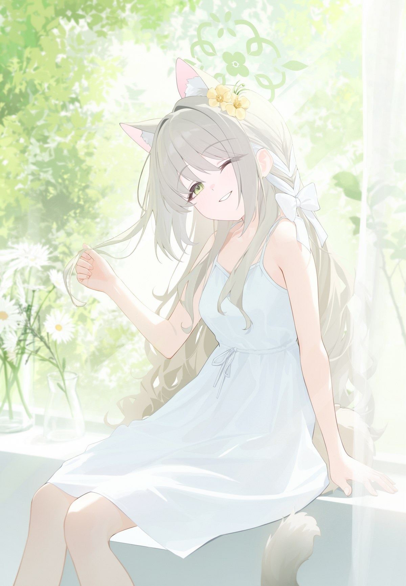
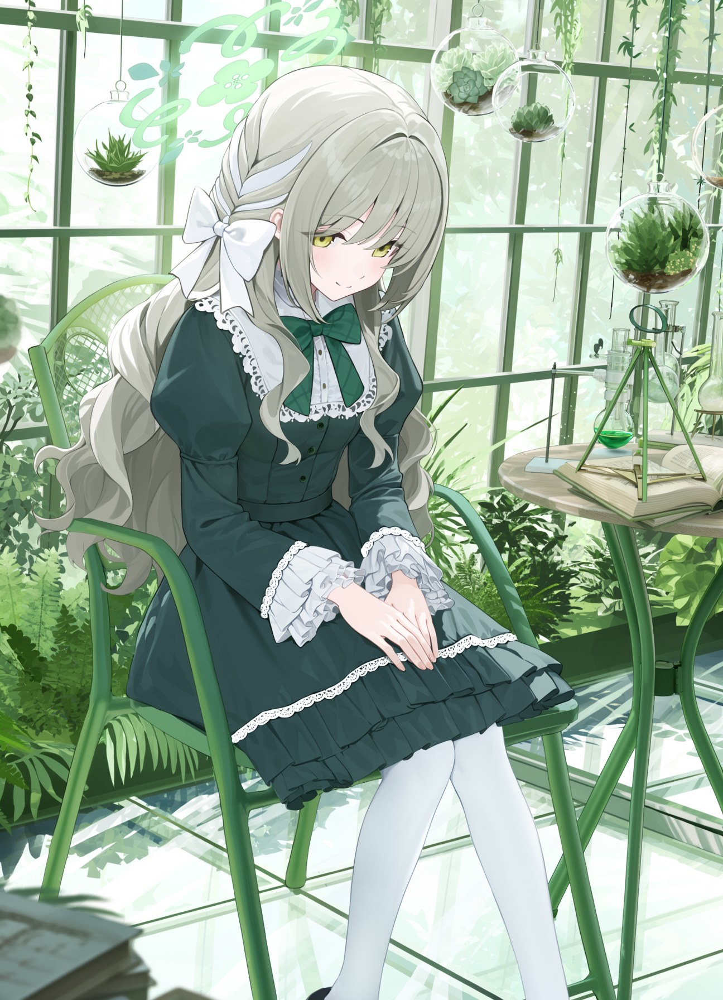
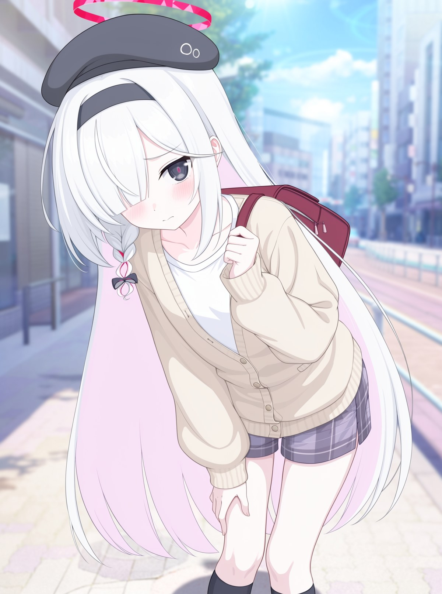
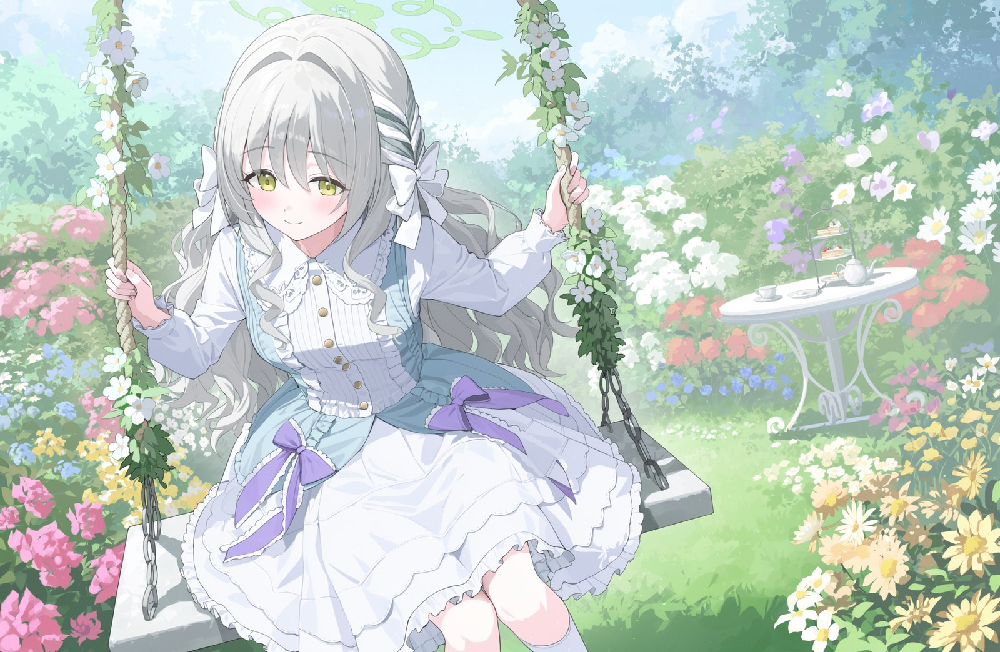
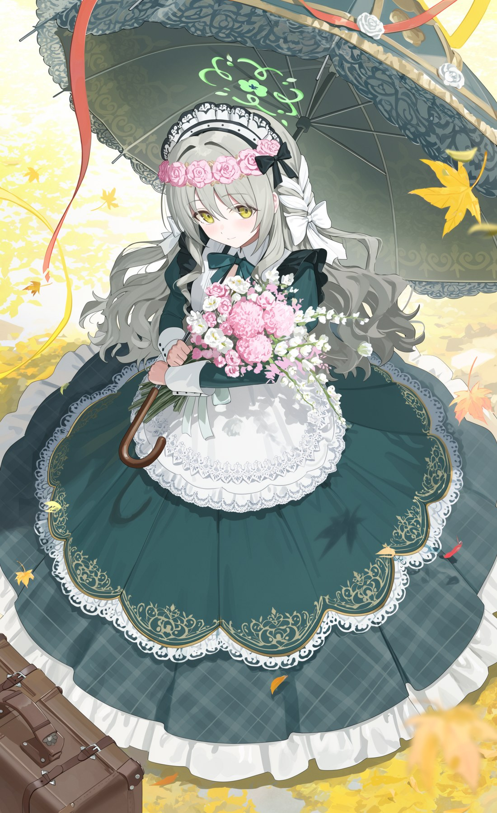

# moss-image-comfyui

MOSS-Image 在本地 ComfyUI 上出图的实战手册，按 [DSH](https://github.com/deepseek-ai) skill 格式组织。

MOSS-Image 是 OpenMOSS 2026-10 开源的 5B 单流 DiT 文生图模型（Qwen3.5-9B 文本编码器 + FLUX.2 VAE，Apache 2.0）。ComfyUI 0.41.0 起原生支持，但官方文档只给了参数范围，没写清楚哪些边界踩了会直接失败。这份手册记录的全是在一张 RX 7900 XT 上跑了几百张图之后量出来的数字。


## 为什么需要这份东西

MOSS 有几个反直觉的行为，不知道的话第一张就会失败：

**套 `ModelSamplingSD3` 会输出纯彩色噪声。** 这个节点的默认 `multiplier=1000` 和 MOSS 内置的 `multiplier=1.0 / shift=5.0` 冲突，sigma 时间步被错放了 1000 倍。shift 5.0 本来就是内置的，不需要任何额外节点——这条几乎没人写。

**图生图的 denoise 不能低于 0.85。** MOSS 没有做过 img2img 训练，图像编码出的 latent 只有在接近纯噪声的起点才能正常去噪。实测 0.9 正常、0.8 出现噪点、0.65 明显劣化、0.45 是纯噪声。想要"轻微修图"做不到，它给的是"锁构图换风格"。

**分辨率上限 2.3MP。** 2016×1152 稳定，2688×1536 会打爆 20GB 显存把进程直接干掉。但低于 1.5MP 时人物五官必糊——这是一对互相挤压的约束，对应的是"要么出小图要么崩"的实际困境。

**中文描述比英文 tag 更强。** 这一条和大部分模型相反。角色身份必须用 Danbooru 官方 tag（写中文名会被理解成同姓的其他角色），但场景、动作、材质、光线用中文写得越长越准——"脚边木盘里切好的西瓜和一把小刀"这种空间关系，tag 拼不出来。

## 混合提示词的写法

```
masterpiece, best quality, anime style, cel shading,
[角色tag], [作品tag], @[画师名],
[中文场景/动作/光线/材质描述]
```

顺序遵循 MOSS 官方推荐的 Danbooru 惯例：Quality → Score → Meta → Year → Character → Series → Artist → General。

引擎之外的英文 tag 只用来锚定身份与画风，其余交给中文。像"光从左上斜射，斑驳树影落在她身上，逆光让发丝与裙摆边缘透亮发光"这类描述，tag 拆不出来，中文一句就够。




L3 档位（全描述）适合这种元素密集的场景：温室的金属框架、悬挂的多肉玻璃球、烧瓶三脚架和摊开的书，逐件点名加方位，一次写满两百字。中文写得越长，MOSS 越不容易丢元素。



## 内容结构

主文档只留每次生成都必须知道的硬约束（73 行），细节按需读。这是刻意的——skill 被加载时主文档全量进上下文，分册按需拉取。

| 文件 | 内容 |
|---|---|
| [`SKILL.md`](SKILL.md) | 五条硬性原则、权重选型表、采样参数、提示词核心、文件导航 |
| [`reference/prompting.md`](reference/prompting.md) | 复杂度分级（L1/L2/L3）、十维清单、十一个变量模板与候选词组库 |
| [`reference/replication.md`](reference/replication.md) | 参考图复刻四步流程、十二项问题修正对照表 |
| [`reference/workflows.md`](reference/workflows.md) | 四种工作流、性能数据、故障对照、配套节点 |
| [`reference/examples.md`](reference/examples.md) | 四组实测完整提示词（单双人、变量替换） |

## 变量模板

做系列图或换角色重跑时，把提示词拆成变量。关键点：**前三项必须是英文 tag，后面全是中文。**

```
masterpiece, best quality, anime style, cel shading,
{{character_tag}}, {{series_tag}}, @{{artist}},
{{outfit}}，{{pose}}，{{scene}}，{{props}}，{{lighting}}，{{mood}}，{{composition}}
```

换角色只动 `character_tag` 和 `series_tag`，其余全部复用；换画风只动 `artist`。同一套构图做多个角色版本时，把原角色的发色瞳色写进负面防止串色。



## 参考图复刻

用户丢一张参考图说"换成某某"时，拆成八项走：主体身份、服装、道具、场景、光线、视角与构图、姿势、表情。身份类全部换成目标角色的官方设定，构图类保留，参考图的角色特征写进负面防止残留。

出图后逐项核，哪项不对就定位到描述词改，不要整体重写。手册里整理了十二项高频问题的对策——腿被拉长、手指畸形、服装跑偏、表情不对、构图变形、双人串味、画面发闷、光柱被过曝吞掉等等。

其中一条值得单独说：**光柱和朦胧感在 MOSS 里互相拉扯**。整体提亮到高调，丁达尔光柱就会被白茫茫吃进去；保住光柱，画面就发闷。这两个没法同时要。



## 用法

作为 DSH skill 安装：

```bash
git clone https://github.com/<your-name>/moss-image-comfyui.git ~/.dsh/skills/moss-image-comfyui
```

也可以直接当文档读——`reference/` 下四个文件是自包含的 Markdown。

如果你的 agent 支持 skill 目录约定，把整个仓库丢进 skills 目录即可，`SKILL.md` 的 frontmatter 会自动注册。



## 实测环境

| 项 | 值 |
|---|---|
| GPU | RX 7900 XT 20GB |
| 后端 | ROCm 7.14 / torch 2.12 |
| ComfyUI | 0.41.0 |
| 采样 | 50~60 步 / cfg 3.5 / euler + sgm_uniform / SLG 22 层 |
| 耗时 | 2.3MP 约 225~240s；1MP/50步 约 70s（量化） |

权重用 int8_convrot DiT + w4a8 文本编码器。`comfy-kitchen` 的 HIP 后端提供真实量化 kernel（`int8_linear`、`dequantize_int8_convrot_weight_dtype`），不是模拟反量化，画质无明显损失而速度提升 3~10 倍。

## 许可

MIT。手册里的参数与结论可自由使用；示例图为实测产出，可作参考但请勿用于商业训练。
